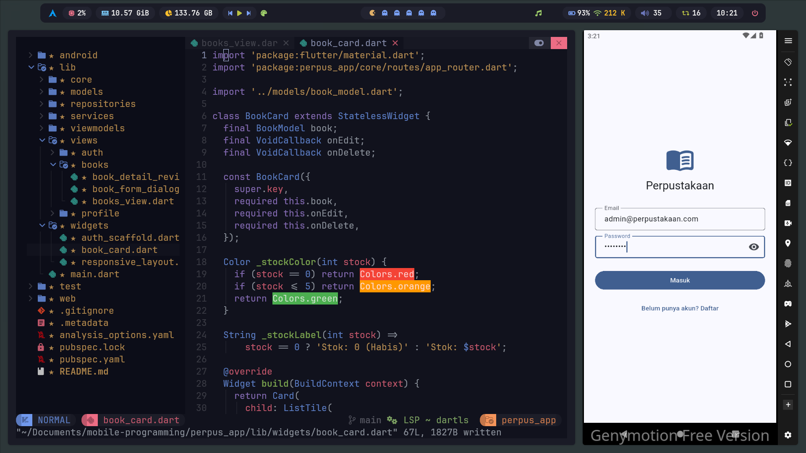
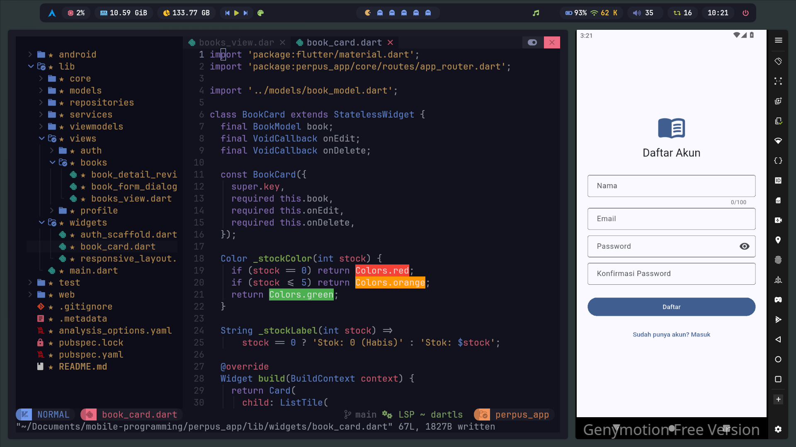
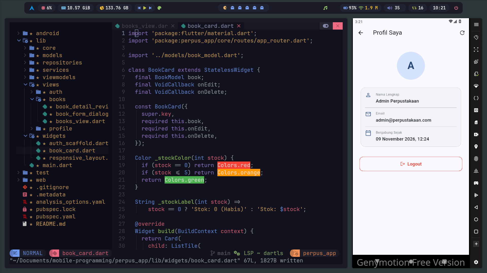
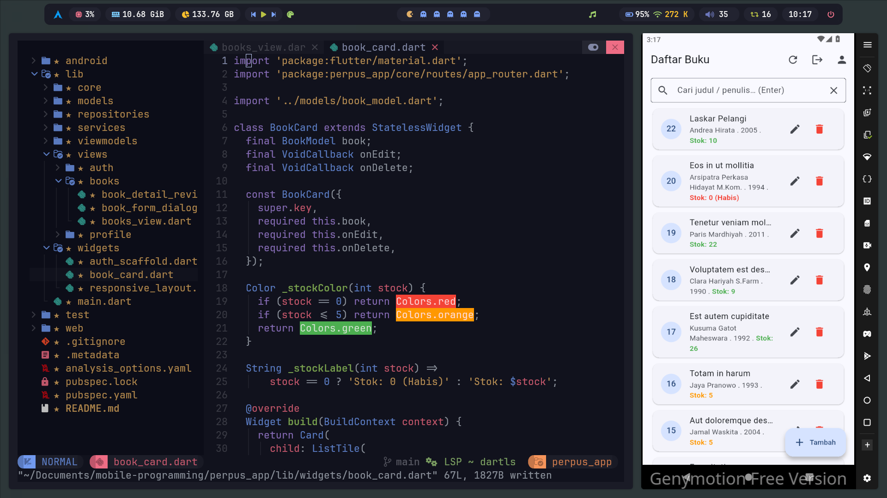
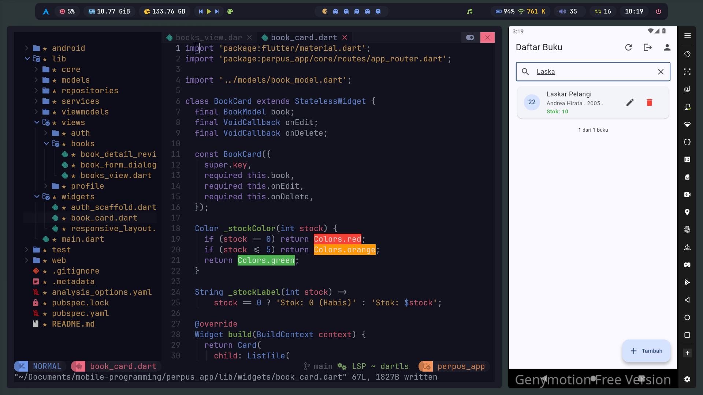
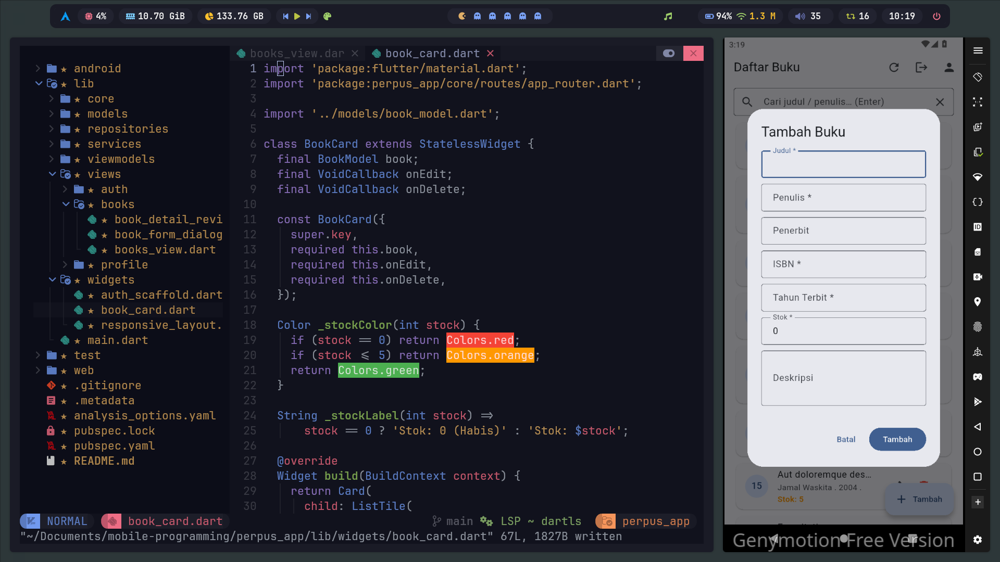
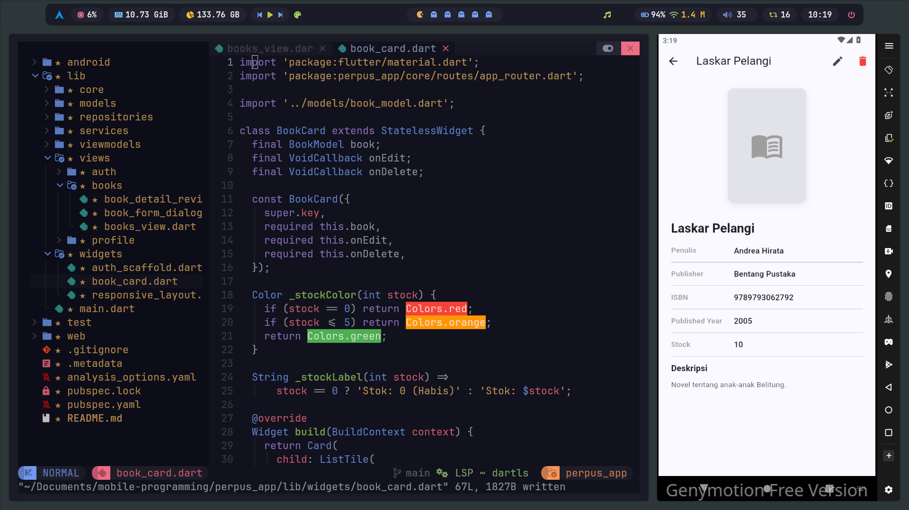
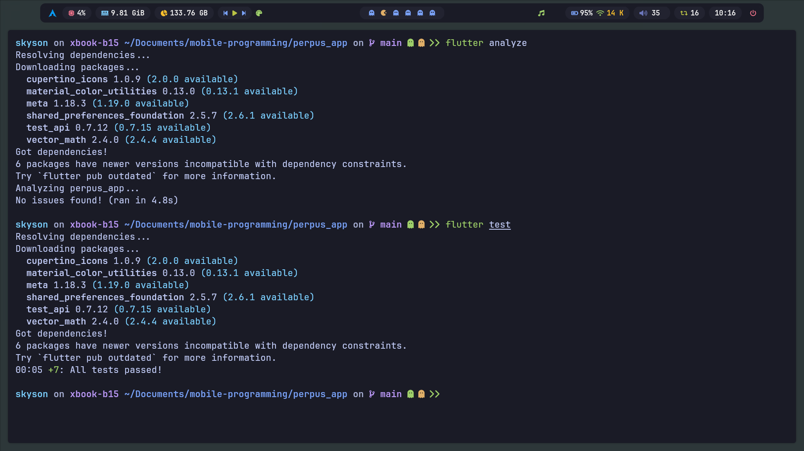

# 📚 Perpus App

Aplikasi **Perpustakaan** berbasis Flutter yang terhubung ke REST API Laravel (`perpus-api`).
Satu codebase berjalan di **Android** dan **Web Browser**.

Proyek ini merupakan hasil pengerjaan modul praktikum *Mobile Programming*: **Membangun Aplikasi Flutter dengan REST API Laravel** (MVVM + Riverpod + Dio), lengkap dengan Tugas A, B, dan C.

---

## ✨ Fitur

| Fitur | Endpoint Backend |
|---|---|
| Registrasi akun baru | `POST /api/register` |
| Login & simpan token | `POST /api/login` |
| Login otomatis (pulihkan sesi) | `GET /api/me` |
| Logout | `POST /api/logout` |
| Daftar buku + pencarian + paginasi (infinite scroll) | `GET /api/books?search=&page=&per_page=` |
| Tambah buku | `POST /api/books` |
| Edit buku | `PUT /api/books/{id}` |
| Hapus buku | `DELETE /api/books/{id}` |

Fitur pendukung:

- Autentikasi **Laravel Sanctum** (Bearer Token) lewat interceptor Dio.
- Penanganan error API: validasi **422** ditampilkan per field, token kedaluwarsa **401** otomatis diarahkan ke halaman login.
- UI **responsif**: tampilan HP (FAB) untuk lebar `< 768px` dan tampilan desktop (`NavigationRail`) untuk `>= 768px`.
- Pull-to-refresh, snackbar notifikasi, dan state loading/kosong/error.

### Tugas yang Dikerjakan

| Tugas | Deskripsi | Berkas Utama |
|---|---|---|
| Latihan 3 | Warna stok: merah (0 / habis), oranye (≤ 5), hijau (> 5) | `lib/widgets/book_card.dart` |
| **Tugas A** | Halaman Detail Buku dengan tombol Edit & Hapus | `lib/views/books/book_detail_review.dart` |
| **Tugas B** | Halaman Profil User (`GET /api/me`): nama, email, tanggal bergabung, Logout | `lib/views/profile/profile_view.dart` |
| **Tugas C** | Pencarian otomatis (*debounce* 500 ms) tanpa harus menekan Enter | `lib/views/books/books_view.dart` |

---

## 🖼️ Tampilan Aplikasi

### 1. Authentication

#### 1.1 Login


#### 1.2 Register


#### 1.3 Profile


### 2. Halaman Utama

#### 2.1 Daftar Buku


#### 2.2 Live Search (Debounce)


#### 2.3 Tambah Buku


#### 2.4 Edit Buku


#### 2.5 Detail Buku


### 3. **Hasil `flutter analyze` dan `flutter test`:**



---

## 🏗️ Arsitektur (MVVM)

Data mengalir satu arah. View hanya membaca state dan memanggil method ViewModel; View **tidak** memanggil Dio/API secara langsung.

```
View  →  ViewModel (Riverpod Notifier)  →  Repository  →  Service (Dio / SharedPreferences)  →  Laravel API
```

| Layer | Tanggung Jawab |
|---|---|
| **View** | Menampilkan UI, membaca state (`ref.watch`), memanggil method ViewModel, navigasi, dialog/snackbar |
| **ViewModel** | Menyimpan state UI, memanggil Repository, menangkap `ApiException` |
| **Repository** | Memanggil `ApiService` & `StorageService`, mengubah JSON menjadi Model |
| **Service** | Komunikasi HTTP dan penyimpanan lokal |
| **Model** | Representasi data API (`fromJson` / `toJson`) |

### Struktur Direktori

```
lib/
├── core/
│   ├── constants/api_constants.dart    # base URL & path endpoint
│   ├── network/dio_client.dart         # Dio + interceptor token & 401
│   ├── network/api_exception.dart      # terjemahan error API
│   ├── routes/app_router.dart          # nama route + navigatorKey
│   └── theme/app_theme.dart            # tema Material 3
├── models/
│   ├── user_model.dart                 # + createdAt (tanggal bergabung)
│   └── book_model.dart                 # BookModel + BookPage (paginasi)
├── services/
│   ├── storage_service.dart            # simpan/ambil/hapus token (dengan cache)
│   └── api_service.dart                # wrapper GET/POST/PUT/DELETE
├── repositories/
│   ├── auth_repository.dart            # + getProfile()
│   └── book_repository.dart
├── viewmodels/
│   ├── providers.dart                  # Riverpod provider graph
│   ├── auth_vm.dart
│   └── book_vm.dart
├── views/
│   ├── auth/       (splash_view, login_view, register_view)
│   ├── books/      (books_view, book_form_dialog, book_detail_review)
│   └── profile/    (profile_view)
├── widgets/        (responsive_layout, auth_scaffold, book_card)
└── main.dart
test/
└── widget_test.dart
```

---

## 🧰 Teknologi

| Komponen | Versi |
|---|---|
| Flutter / Dart | SDK `^3.13.7` (sesuai `pubspec.yaml`) |
| flutter_riverpod | ^3.5.0 |
| dio | ^5.11.1 |
| shared_preferences | ^2.5.6 |
| intl | ^0.20.3 |
| Backend | Laravel 12 + PHP 8.3 + Sanctum + L5-Swagger ([perpus-api](https://github.com/frizennwave/perpus-api)) |

---

## 🚀 Cara Menjalankan

### 1. Siapkan Backend

Backend: **perpus-api** (Laravel 12, PHP 8.3, Sanctum, L5-Swagger)
Repositori: <https://github.com/frizennwave/perpus-api>

```bash
git clone https://github.com/frizennwave/perpus-api.git
cd perpus-api
```

Pilih **salah satu** cara menjalankan di bawah ini.

#### Opsi A — PHP lokal

Prasyarat: PHP 8.3+ dan Composer.

```bash
composer install
cp .env.example .env
php artisan key:generate

# Atur database di .env (MySQL atau SQLite), lalu tambahkan:
#   APP_URL=http://localhost:8000
#   L5_SWAGGER_CONST_HOST=http://localhost:8000
#   L5_SWAGGER_GENERATE_ALWAYS=true

php artisan migrate:fresh --seed
php artisan l5-swagger:generate
php artisan serve
# -> http://localhost:8000
```

Jika memakai SQLite: `touch database/database.sqlite` dan set `DB_CONNECTION=sqlite` di `.env`.

#### Opsi B — Laravel Sail / Docker

Prasyarat: **Docker Desktop** (atau Docker Engine + Compose) yang sedang berjalan. PHP dan Composer **tidak perlu** terpasang di laptop. Pada Windows, jalankan perintah di dalam **WSL2** (Ubuntu).

```bash
# 1. Salin environment
cp .env.example .env

# 2. Install dependency Composer lewat container
#    (vendor/ belum ada saat pertama kali clone, jadi Sail belum bisa dipakai)
docker run --rm \
    -u "$(id -u):$(id -g)" \
    -v "$(pwd):/var/www/html" \
    -w /var/www/html \
    laravelsail/php83-composer:latest \
    composer install --ignore-platform-reqs

# 3. Jalankan container
./vendor/bin/sail up -d

# 4. Generate key, migrasi + seeder
./vendor/bin/sail artisan key:generate
./vendor/bin/sail artisan migrate:fresh --seed

# 5. Generate dokumentasi Swagger
./vendor/bin/sail artisan l5-swagger:generate
```

Atur `.env` sebelum langkah 3 (nilai database harus cocok dengan layanan di `compose.yaml`):

```dotenv
APP_URL=http://localhost
L5_SWAGGER_CONST_HOST=http://localhost
L5_SWAGGER_GENERATE_ALWAYS=true

# Jika compose.yaml memakai layanan MySQL, host database = nama layanan, bukan 127.0.0.1
DB_CONNECTION=mysql
DB_HOST=mysql
DB_PORT=3306
DB_DATABASE=perpus_api
DB_USERNAME=sail
DB_PASSWORD=password
```

Sail secara bawaan membuka aplikasi di port `80` (`APP_PORT`), sehingga alamat API menjadi `http://localhost/api`.
Jika port 80 bentrok, tambahkan `APP_PORT=8000` di `.env` lalu ubah `APP_URL` dan `L5_SWAGGER_CONST_HOST` menjadi `http://localhost:8000`.

Perintah Sail yang sering dipakai:

| Perintah | Fungsi |
|---|---|
| `./vendor/bin/sail up -d` | Jalankan container di latar belakang |
| `./vendor/bin/sail down` | Hentikan container |
| `./vendor/bin/sail down -v` | Hentikan container dan hapus volume database |
| `./vendor/bin/sail artisan <perintah>` | Jalankan perintah Artisan |
| `./vendor/bin/sail test` | Jalankan test backend |
| `./vendor/bin/sail logs -f` | Lihat log container |

> Tips: buat alias agar lebih singkat: `alias sail='./vendor/bin/sail'`.
> Jika Sail belum tersedia di `composer.json`, gunakan `docker compose up -d` dengan `compose.yaml` yang ada di repositori.

#### Verifikasi API

Buka dokumentasi Swagger:

- PHP lokal: `http://localhost:8000/api/documentation`
- Sail: `http://localhost/api/documentation`

**Akun demo** (dari seeder): `admin@perpustakaan.com` / `password`
Salin token dari respons login, klik **Authorize**, lalu tempel token (tanpa kata `Bearer`).

> ⚠️ Endpoint login dibatasi 6 percobaan per menit. Jika muncul error 429, tunggu 1 menit.

### 2. Siapkan Aplikasi Flutter

```bash
git clone <url-repo-ini>
cd perpus_app
flutter pub get
```

### 3. Atur Base URL

Base URL dipilih otomatis di `lib/core/constants/api_constants.dart`:

| Target | URL bawaan |
|---|---|
| Web / desktop / iOS simulator | `http://localhost/api` |
| Android (emulator Genymotion) | `http://10.0.3.2/api` |

> Nilai di atas disesuaikan dengan environment pengembangan saya (backend lewat Laravel Sail di port 80, emulator Genymotion).
> Jika backend Anda memakai `php artisan serve` (port 8000), jalankan dengan `--dart-define` agar tidak perlu mengubah kode:

```bash
# Web (Chrome)
flutter run -d chrome --dart-define=API_BASE_URL=http://localhost:8000/api

# Emulator Android Studio (localhost laptop = 10.0.2.2)
flutter run --dart-define=API_BASE_URL=http://10.0.2.2:8000/api

# HP fisik (satu jaringan Wi-Fi; backend: php artisan serve --host=0.0.0.0)
flutter run --dart-define=API_BASE_URL=http://<IP-LAPTOP>:8000/api
```

### 4. Verifikasi Kode

```bash
flutter analyze            # No issues found!
flutter test               # All tests passed! (7 test)
flutter build apk --debug  # build APK debug
```

---

## 🧪 Pengujian

`test/widget_test.dart` memuat 7 pengujian:

- **Model & parsing** — `BookPage.fromJson` (data + meta paginasi), `ApiException` untuk 422, dan pesan saat server tidak terjangkau.
- **BookNotifier** (memakai `FakeBookRepository`, tanpa server) — `load` + `loadMore`, `create` gagal tidak menghapus daftar, dan `delete`.
- **Widget** — validasi lokal form buku dan tampilnya error ISBN dari backend.

### Checklist Uji Manual

| No | Skenario | Hasil yang Diharapkan |
|---|---|---|
| 1 | Login dengan password salah | Pesan error di bawah field Email |
| 2 | Login `admin@perpustakaan.com` / `password` | Masuk ke Daftar Buku |
| 3 | Scroll sampai bawah | Halaman berikutnya dimuat |
| 4 | Tambah buku dengan ISBN yang sudah ada | Dialog tetap terbuka, error di field ISBN |
| 5 | Tambah buku dengan ISBN baru | Buku muncul di atas daftar + snackbar |
| 6 | Edit stok buku | Stok berubah + snackbar |
| 7 | Ketik di kolom pencarian | Daftar terfilter otomatis setelah 500 ms |
| 8 | Hapus buku | Buku hilang dari daftar + snackbar |
| 9 | Tutup lalu buka lagi aplikasi | Langsung masuk ke Daftar Buku tanpa login |
| 10 | Register dengan email yang sudah terdaftar | Error di bawah field Email |
| 11 | Buka Profil | Nama, email, dan tanggal bergabung tampil |
| 12 | Logout | Kembali ke halaman login |
| 13 | Lebar jendela `< 768px` dan `>= 768px` | Tampilan HP (FAB) dan desktop (sidebar) |

---

## 🛠️ Troubleshooting Singkat

| Gejala | Solusi |
|---|---|
| "Tidak dapat terhubung ke server" | Pastikan backend berjalan dan `baseUrl` benar |
| Emulator Android tidak bisa konek | Emulator Android Studio: `10.0.2.2`; Genymotion: `10.0.3.2` |
| HP fisik tidak bisa konek | `php artisan serve --host=0.0.0.0` + `--dart-define=API_BASE_URL=...` |
| Error CORS di browser | Pastikan `config/cors.php` backend mengizinkan `api/*` dan origin web Flutter |
| Port 80 sudah dipakai (Sail) | Set `APP_PORT=8000` di `.env` backend, lalu sesuaikan `API_BASE_URL` |
| Error 429 | Tunggu 1 menit (batas login 6x/menit) |
| Selalu kembali ke login (401) | Token kedaluwarsa/dicabut; login ulang |

---

## ⚠️ Catatan Keamanan

- Token disimpan dengan `SharedPreferences` (tidak terenkripsi). Untuk produksi gunakan `flutter_secure_storage`.
- Akses HTTP non-HTTPS (`usesCleartextTraffic`) hanya untuk pengembangan; aplikasi produksi wajib memakai HTTPS.

---

